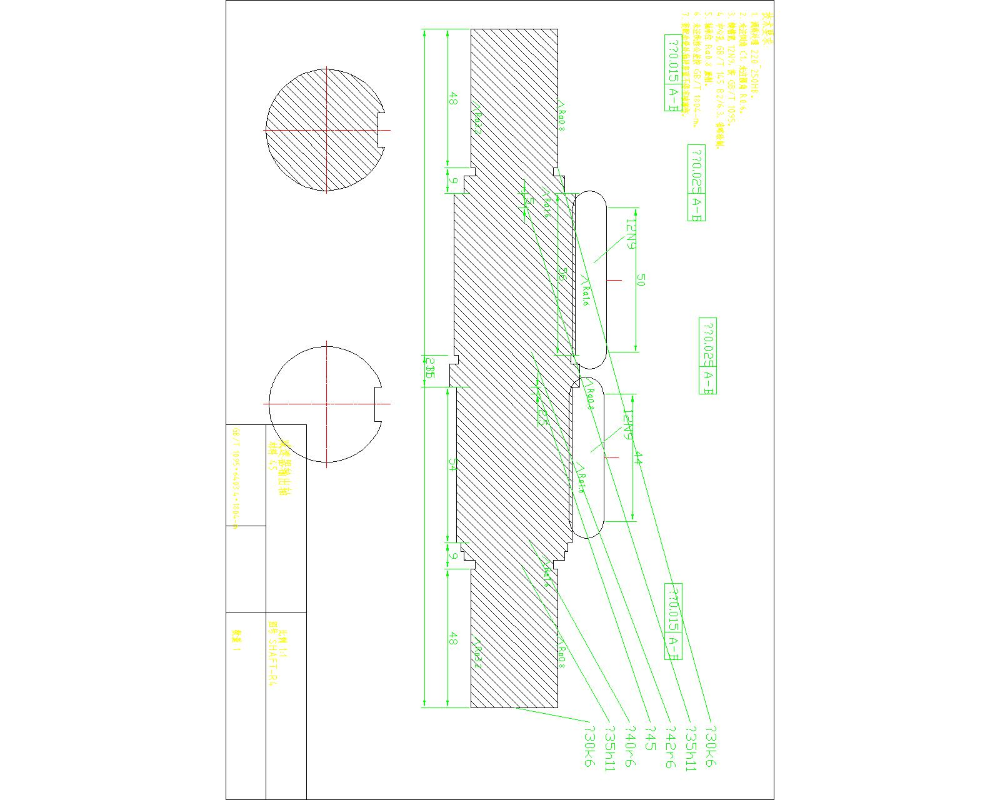
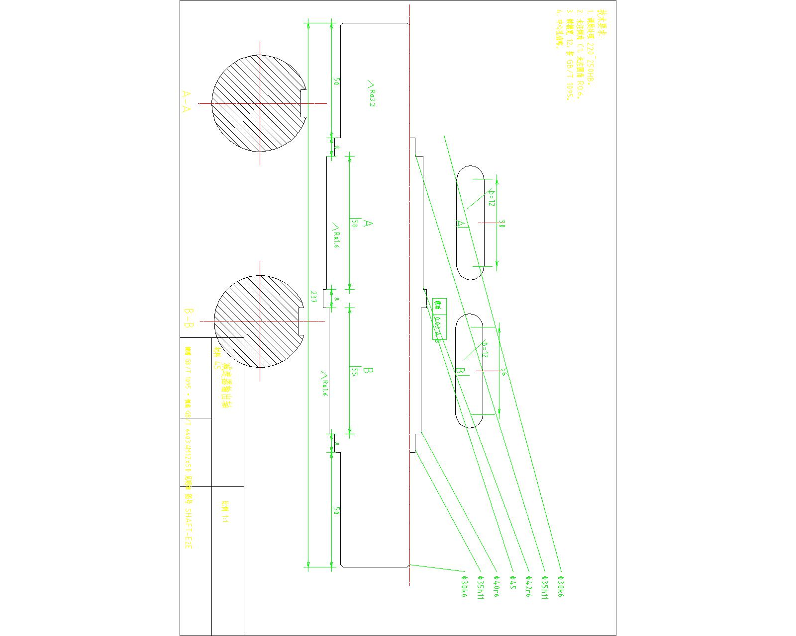
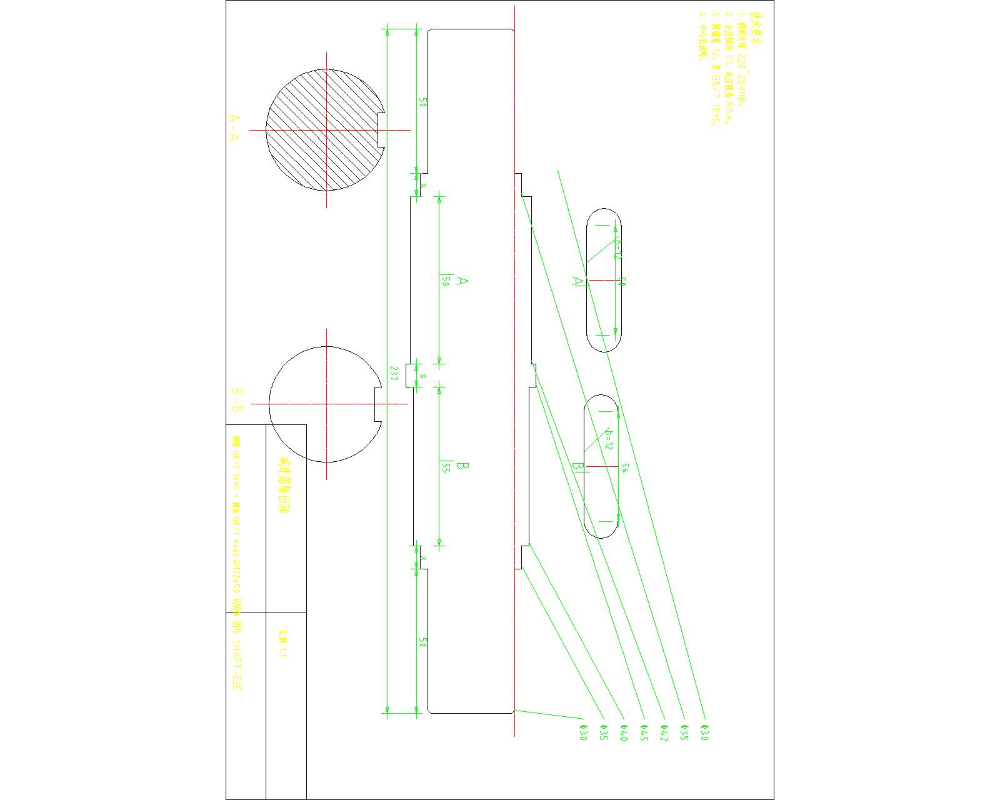

# AutoCAD Live MCP

> **44 个工具的 AutoCAD 实时操控 MCP 服务** —— 让 AI agent 用自然语言直接驱动你打开的 AutoCAD 2026，画工业级图纸。

从"画一个Φ60的圆"到"生成一张带公差代号、粗糙度符号、形位公差框格、明细栏 BOM 的减速器装配图"，一条 MCP 链路。

[](https://python.org)
[](LICENSE)
[]()
[()]

---

## 实际产出

### 一级圆柱齿轮减速器装配图（A3 · 251 实体）

双轴系剖视（中心距 80±0.031）· 大齿轮 φ112 与小齿轮 φ52 啮合 · 轴承×4 简化画法 · 箱体剖分面与螺栓组 · 零件序号气球 ×12 · 明细栏 BOM 10 行 · 技术特性表 · 技术要求 6 条 · 标题栏



### 输出轴零件图（工业密集版 · 200 实体）

7 段阶梯轮廓 + 砂轮越程槽×4 · 双键槽嵌入 · 移出剖面 A-A/B-B（ANSI31 剖面线）· 直径引出栈带公差带代号（φ30k6/φ42r6/φ40r6）· 形位公差框格 ×4（跳动 0.015/0.025 A-B）· 基准符号 A/B · 粗糙度符号 ×9 · 三层尺寸链 · 技术要求 7 条



### 公差与粗糙度细节



---

## 为什么是这个项目

市面上已有的 AutoCAD MCP 服务解决了"能不能操控"的问题。本项目在此基础上回答三个追问：

| 追问 | 我们的答案 |
|------|-----------|
| **快不快？** | 唯一公开延迟基准：单操作 31ms，批量 237 实体/s，万级分页查询 <1s |
| **稳不稳？** | 写操作防重放（断连绝不重复绘制）、可疑态熔断（连续超时快速拒绝）、看门狗保护 |
| **像不像生产图？** | 真 RotatedDimension/Fcf/Leader 对象 + 公差带代号 + 粗糙度符号 + 形位公差框格 + BOM |

## 性能基准（AutoCAD 2026, MCP stdio 全往返）

```
单图元落图          31 ms
批量吞吐            237 entities/s
万级实体分页查询     首页 453ms / 深页 515ms
状态轮询            15 ms
截图导出            1.1 s
```

## 快速开始

### 前置条件
- Windows 10/11 + AutoCAD 2026 完整版（非 LT）
- Python 3.12+

### 安装
```bash
pip install fastmcp mcp pywin32 pillow pytest
```

### 注册到你的 MCP 客户端
```json
{
  "autocad": {
    "command": "python",
    "args": ["path/to/src/cad_mcp/server.py"]
  }
}
```

### 30 秒验证
```bash
# 确保 AutoCAD 已打开且有活动图纸
python src/cad_mcp/smoke_suite.py
# 输出 ALL PASS 即可开始用自然语言指挥 AI 画图
```

## 44 个工具一览

<details>
<summary><b>绘图基础（8）</b></summary>

- `cad_draw_line/circle/arc/polyline/rectangle/text` — 六类图元
- `cad_create_batch` — 尽力而为批量创建（整批一个撤销单元）

</details>

<details>
<summary><b>真标注对象（6）</b></summary>

- `cad_dim_aligned/diameter/radius/rotated` — 真 DIMENSION 对象（非手画线）
- `cad_hatch` — ANSI31 等图案填充
- `cad_draw_mtext` — 多行文本

</details>

<details>
<summary><b>参数化生成器 ★（3）</b></summary>

- `gen_bolt` — GB/T 5782 六角头螺栓双视图（d=8~20）
- `gen_flange` — 板式平焊法兰双视图（全参数化）
- `gen_gear_spur` — 渐开线直齿圆柱齿轮轮廓

</details>

<details>
<summary><b>查询与编辑（7）</b></summary>

- `cad_status/query_entities/get_entity` — 分页查询/句柄详情
- `cad_undo/delete_entities/set_layer_props/list_layers/create_layer`
- `cad_list_documents/activate_document`

</details>

<details>
<summary><b>视觉闭环 ★（2）</b></summary>

- `cad_zoom` — 视图控制
- `cad_export_screenshot` — 截屏回传：agent 画完自己看效果再迭代

</details>

<details>
<summary><b>理解与规划流水线 ★（5）</b></summary>

- `cad_parse_text` — 确定性中英文尺寸解析（零幻觉兜底）
- `cad_plan` → `cad_validate_plan` → `cad_execute_plan` — Plan 一等公民三段式
- `cad_list_rulesets` / ruleset 参数 — 行业规则包引擎

</details>

<details>
<summary><b>输入通道与安全（5）</b></summary>

- `cad_import_image_geometry` — OpenCV 图片→几何（可选依赖）
- `cad_scan_dwg` — 扫描已有 DWG 文件
- `cad_send_command` — LISP 逃生舱
- `cad_leader` / `cad_tolerance_frame` — 引线与形位公差

</details>

## 架构

```
AI Agent ──→ MCP stdio ──→ cad-mcp server (Windows Python)
                              │
                              ├── ComExecutor（唯一 COM 线程，套间安全）
                              ├── Session（附着/惰性重连/可疑态熔断/泄漏上限）
                              ├── Journal（单步撤销操作日志）
                              └── Rules Engine（行业规则包 JSON 外置）
                                      │
                              AutoCAD 2026 COM 接口
```

- **零环境变量设计**：WSL agent 经互操作直拉 Windows Python，无 env 透传风险
- **写防重放**：变更类操作断连绝不自动重试——宁可报错也不画重
- **结构化错误码**：8 类错误码 + 人话 hint，agent 可直接转述给用户

## 与同类项目对比

| | 本项目 | daobataotie/CAD-MCP | puran-water/autocad-mcp | U-C4N/Autocad-MCP |
|---|---|---|---|---|
| 工具数 | **44** | ~10 | 8 | 149(full)/47(lean) |
| 延迟基准 | ✅ 公开 | ✗ | ✗ | ✗ |
| 单测覆盖 | ✅ 80 个 | ✗ | ✗ | 有 CI |
| 写防重放 | ✅ | ✗ | ✗ | 未明确 |
| Plan 三段式 | ✅ | ✗ | ✗ | ✗ |
| 行业规则包 | ✅ JSON 外置 | ✗ | ✗ | ✗ |
| 视觉闭环 | ✅ 截图回传 | ✗ | ✗ | ✗ |
| 参数化生成器 | ✅ 螺栓/法兰/齿轮 | ✗ | ✗ | 齿轮 |
| 无头模式 | 📍 规划中 | ✗ | ✅ ezdxf | ✅ ezdxf |

## 生产就绪度

详见 [PRODUCTION_READINESS.md](PRODUCTION_READINESS.md)。诚实结论：
**当前为「单工作站生产级」**——单人本机场景已过 P0 加固（防重放/熔断/冒烟套件/CI），
P1 已完成三项（结构化日志/只读模式/安全声明），浸泡框架就绪。

剩余待做：8h 全量浸泡挂机 · 兼容性矩阵扩展 · PyPI 发包。

## 安全边界

⚠️ **单用户本机设计**。MCP stdio 无鉴权；`cad_send_command` 等同任意命令执行。
详见 [SECURITY.md](SECURITY.md)。

## 许可

MIT
